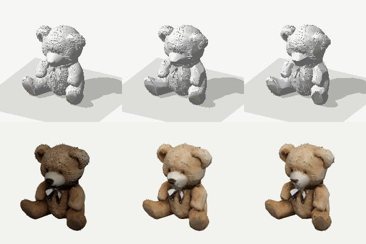
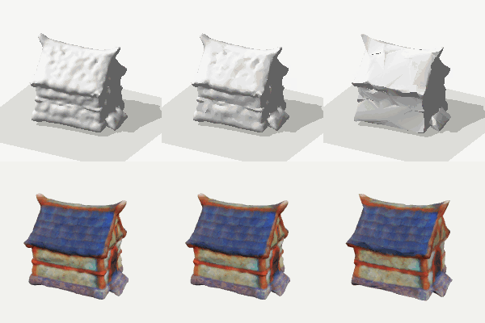

# og-shape

**3D modeling in Rust, built for LLMs.**

A model writes a 3D object as a short program: profiles, solids, booleans,
fillets, shells, text, named parts and joints. Faces and edges are reached by
name, never by computed coordinates. The program is the asset. The kernel
builds it into a mesh that is identical bit for bit on x86-64, aarch64 and
wasm32. The same kernel repairs, decimates, unwraps, measures, previews and
exports any mesh, wherever it came from.

og-shape is developed here, outside the engine, so that its work never
touches the engine's gate, landing queue or lanes. When its plan's merge
phase is reached (`docs/plan.md` §M), it moves into origin-engine. There its
Rust crates are vendored, its API becomes the IDL module `og.shape`, and its
tools become `og model` commands. The platform uses it only through a
released engine.

Status: every phase of `docs/plan.md` but the merge is done; the table in
its §Status is the record. The merge (phase M) waits for the owner. Run
the gate with `scripts/check.sh` (needs cargo-deny and wasmtime).

## What it makes

Each image is the kernel's own CPU preview (`shape preview`), no GPU.

| | | |
|---|---|---|
|  |  |  |
| A toaster: a lofted housing with a filleted top, slots, a lever and a knob on joints. Written by an agent from a brief (`eval/phase6/Z/Z1/sim3_toaster`). | Spectacles with folding arms and lenses at opacity 0.4 (`…/obj4_spectacles`). | The washing machine of `golden/programs/`, posed: the door on a hinge, the drawer on a slide. |

Meshes from elsewhere go through the same kernel:

| | | |
|---|---|---|
|  |  |  |
| Khronos's Duck, as imported and decimated to half, its texture kept (three.js render, `docs/research.md` §17). | `golden/meshes/ball_defects.obj` as it comes: open, in 2 pieces, 79 faces flipped. | After `shape process --budget 1500`: closed, 1 piece, 1 500 triangles, 6 UV charts with no overlap (the lines are chart seams). |

| | |
|---|---|
|  |  |
| A Hunyuan3D-2 bear (150 000 triangles) as generated, at 10 000 and at 2 000, its texture kept; top `shape preview`, bottom three.js (`docs/research.md` §28). | A Meshy barn (37 000 triangles), the same way. Its metallic-roughness map is dropped: only the base colour is kept. |

`docs/previews/` holds more: the bevel cases (`phase3/`), a skinned
figure and Mixamo's Soldier posed (`phase5b/`), the models loaded and
moved in three.js (`validate/`), UVs under a checker (`uv/`), twelve
generated meshes before and after the chain (`generated/`).

## What has been checked

Run on `main` on 2026-11-10; each line says where the numbers come from.

| Check | Result | How |
|---|---|---|
| The same bytes on every host | 134 golden output hashes equal on x86-64 Linux, x86-64 Windows, aarch64 Linux, aarch64 macOS and wasm32 (wasmtime); the binding's GLB and PNG equal under bun and node | the gate in GitHub Actions, every push |
| Tests | 288 pass | `scripts/check.sh test` |
| An agent with only the guides and the MCP tools builds objects | 20 of 20 sand3d dataset objects built, every part closed, 24 of 24 joints as the reference, 2.0 builds an object, 19 ran on the first build | `eval/phase6`, run `Z1` (`docs/research.md` §22) |
| Those 20 programs on today's kernel | 20 of 20 rebuild and export to GLB; 119 of 119 parts closed, no non-manifold edge, no degenerate triangle | `shape measure` on each `program.json` |
| Every committed program | 105 of 107 build (`eval/phase6/**`, `golden/programs/`); the two that do not are a refusal a golden case hashes on purpose and a trial program with a joint declared twice | `shape build` on each |
| No part passes through itself | 140 of 140 built solids have no crossing triangle pair (exact predicates). The mouse's shell had 8: its move into the world folded a needle, now repaired (`docs/research.md` §26) | `crates/shape-model/tests/built_parts.rs`, `shape_bool::crossing_pairs` on every part |
| Bevels never return a wrong result | 17 948 fillets and chamfers on generator and boolean solids: 16 648 built, 1 300 refused with an error value, none returned crossing itself | `cargo run --release -p shape-bevel --example scan` |
| Booleans against outside meshes | 109 cases from sand3d, Thingi10K, synthetic defects and touching operands; no ok output crosses itself with the repair on | `bench/booleans` (`docs/research.md` §25.2) |
| Real generated meshes | 54 files from 8 image- and text-to-3D generators (Hunyuan3D-2, TRELLIS, SPAR3D, TripoSR, InstantMesh, CRM, Unique3D, Meshy): within budget and closed keeping their UVs and texture 40, 49 and 50 at 2 000, 10 000 and 50 000 triangles, 50 at each with fresh UVs (the other 4 are open TRELLIS meshes); 132 of 154 booleans on the results closed, 19 refused with a cause, 3 missed | `bench/generated` (`docs/research.md` §28) |
| The mesh chain on a damaged mesh | open, 2 pieces, 79 flipped faces → closed, 1 piece, on budget, unwrapped with no UV overlap | `shape process golden/meshes/ball_defects.obj` |
| Outside files | glTF, OBJ and FBX from three.js's and Khronos's samples import; textured and skinned ones keep UVs, bones and weights through repair and decimation to half | `docs/research.md` §9, §11.5, §17 |
| three.js reads the output | the washing machine's joints move and a skinned figure poses in headless Chromium; vertex positions match the kernel's own pose | `docs/research.md` §19 |
| A real MCP client | the official TypeScript SDK client and headless Claude Code drive every tool and resource | `docs/research.md` §19 |

Known limits. Each is an error value or a recorded gap; the one marked
silent returns a result with no error:
- **Silent, measured:** a boolean or edit whose result still crosses
  itself after the repair is returned without an error, with the count in
  its report (`crossingPairs`, `BoolReport::crossing_pairs`,
  `shape_edit::EditReport`). No committed program, golden case other than
  `selfunion.check` (its inputs cross by design), bench case, or swept
  `hole`, `pocket`, `seat` or `dent` leaves any; 76 of 4 920 swept
  shells do (950 before), where a rounded corner, chamfer or fillet
  narrower than the wall folds the inner solid beyond what `self_union`
  untangles (`docs/research.md` §27).
- 1 300 of the scan's bevels are refused: too large for the faces (426),
  a lone piece of a crease that does not fit (226), a twisted face (340),
  an edge with more than two faces (308).
- The unwrap is planar per chart, with no atlas packing; the preview
  draws no textures.
- Not read: Draco and meshopt-compressed glTF, morph targets, vertex
  colours. No USD or URDF export.
- The declarative `.ogt` source and `og cook` belong to the merge.

## Use it

From an agent, through MCP (`guides/mcp.md`):

```sh
cargo build --release -p shape-mcp
claude mcp add og-shape -- "$PWD/target/release/shape-mcp" --root /path/to/workspace
```

The agent then has `build`, `preview`, `measure` and `export` for model
programs, `run_typescript` for TypeScript ones (with bun and
`crates/shape-wasm/build.sh`), and `import`, `repair`, `decimate`,
`unwrap` and `process` for meshes from elsewhere. It reads how to write a
program from the server's resources (`guides/`).

From a shell, the same commands (`cargo run -p shape-cli -- help`):

```sh
shape build   model.json                     # parts and joints as JSON
shape preview model.json -o model.png        # a turntable, CPU-rendered
shape export  model.json -o model.glb        # or .obj, .stl
shape process scan.glb --budget 40000 --weld 0.001 --floaters 0.05 \
              --holes 64 --fuse -o asset.glb # repair, decimate, unwrap
```

## Read

- `docs/design.md`: goals, scope, API, architecture, determinism.
- `docs/plan.md`: phases, acceptance and the merge into the engine.
- `docs/research.md`: what has been verified so far: sand3d's real Blender
  dependencies, the library survey, the platform's current 3D pipeline,
  and what the engine already covers.
- `AGENTS.md`: rules for anyone working in this repository.

Licence: MIT (`LICENSE`). Third-party code keeps its own licence under
`third_party/`.
