# og-shape

**3D modeling in Rust, built for LLMs.**

A model writes a 3D object as a short program: profiles, solids, booleans,
fillets, shells, text, named parts and joints. Faces and edges are reached by
name, never by computed coordinates. The program is the asset. The kernel
builds it into a mesh that is identical bit for bit on x86-64, aarch64 and
wasm32. The same kernel repairs, decimates, unwraps, measures, previews and
exports any mesh, wherever it came from.

og-shape is its own project, MIT licensed. It ships as Rust crates, the
`shape` command line, an MCP server and a wasm binding with a TypeScript
API. It was planned as a kernel for origin-engine to absorb; that merge
is not going ahead (`docs/plan.md` §M).

Status: every phase of `docs/plan.md` is done but the merge, which is
dropped; the table in its §Status is the record. Run the gate with
`scripts/check.sh` (needs cargo-deny and wasmtime).

## What it makes

Each image is the kernel's own CPU preview (`shape preview`), no GPU.

| 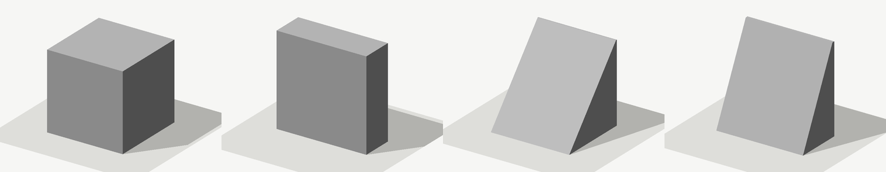

Morph targets are read, carried through repair and decimation, and
written back with the clips that drive them. Khronos's AnimatedMorphCube
at rest, at 1 s and 3 s of its clip, and with both targets at a half
(`shape preview file --morph target0=0.5,target1=0.5`).

| | |
|---|---|---|
| 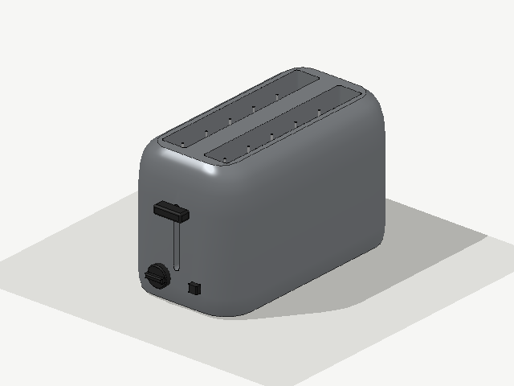 | 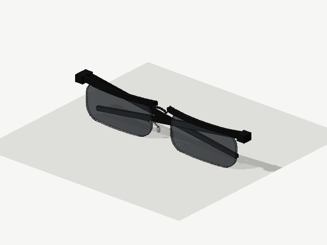 | 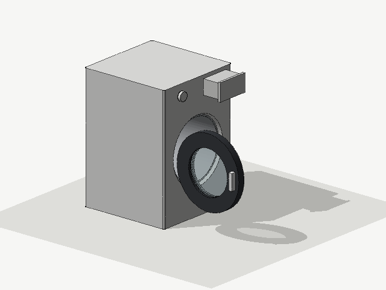 |
| A toaster: a lofted housing with a filleted top, slots, a lever and a knob on joints. Written by an agent from a brief (`eval/phase6/Z/Z1/sim3_toaster`). | Spectacles with folding arms and lenses at opacity 0.4 (`…/obj4_spectacles`). | The washing machine of `golden/programs/`, posed: the door on a hinge, the drawer on a slide. |

Soft forms are a blocky cage rounded by `subdivide`, and every part can
get convex colliders:

| | |
|---|---|
| 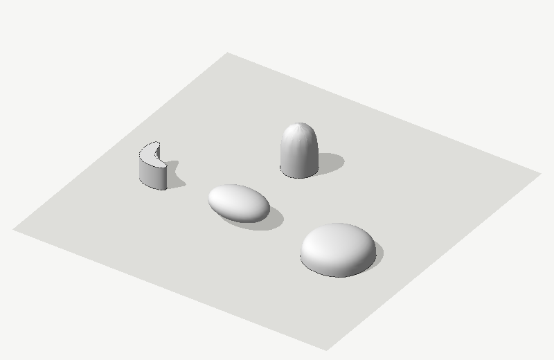 | 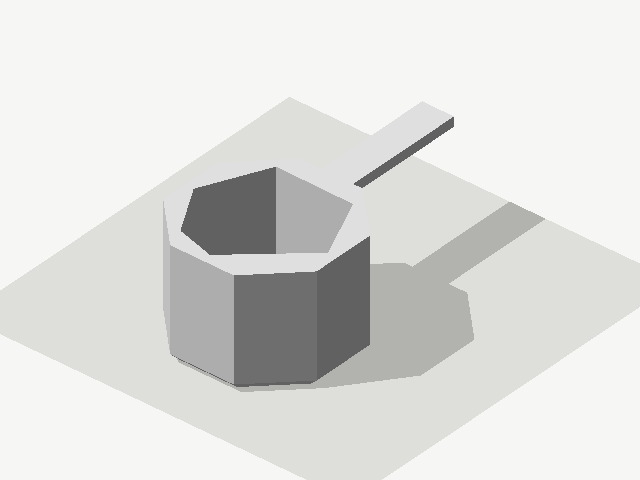 |
| An L with sharp caps, a 12-sided can with a sharp base, a box rounded all over and one on a sharp base. | A cup and its handle covered by 16 convex hulls (`shape collide`): the hollow stays open. |

A loft bends through space and closes into a loop; a shell may be
thicker than the part's rounded corners, fillets or chamfers:

| | |
|---|---|
| 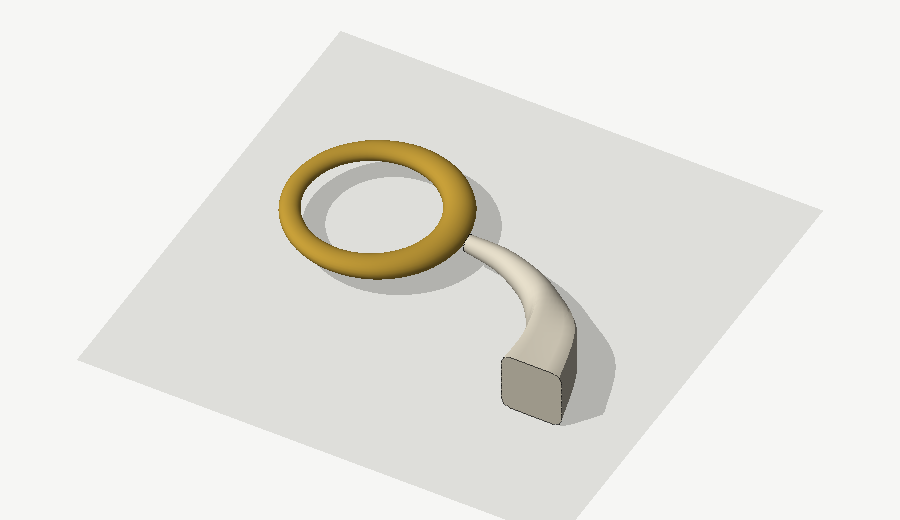 | 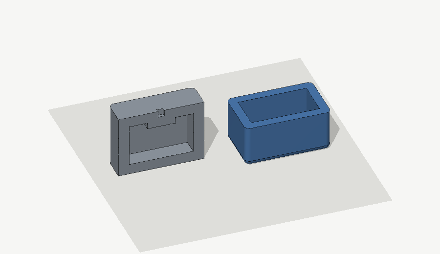 |
| `loft` through sections placed by frames (`docs/previews/readme/src/loft_along.json`): a bangle, twelve ellipses round a ring with `closed`, and a horn from a rounded square to a circle along a quarter bend. | `docs/previews/readme/src/thick_shells.json`. Left, cut open: a case with corners of radius 5 and a pocket in its top, hollowed 10 thick; the corners are gone from the hollow, the pocket's wall is kept. Right: a tray whose bottom fillet is as wide as its corners (5), hollowed 8 thick, open at the top. |

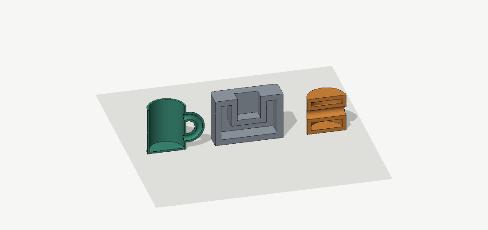

`docs/previews/readme/src/shell_pieces.json`, each cut open. A mug 2
thick: the handle's hollow opens into the cup's. A case 6 thick whose
pocket's own wall reaches through the case's: the hollow is cut into
chambers round it. A can 4 thick with a hole through its side: the
hole's wall crosses the hollow.

Joints move by clips, written to the GLB as animations:

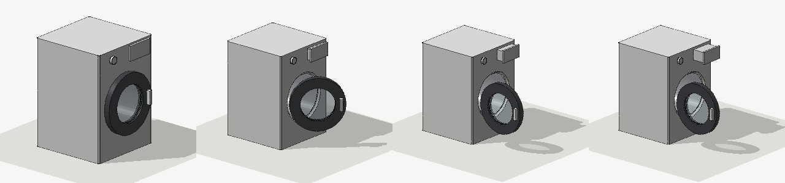

The clip `open` of `golden/programs/washing_machine_clips.json` at 0, 0.4,
0.8 and 1.4 s: the door swings on its hinge, then the drawer slides out.

Meshes from elsewhere go through the same kernel:

| | | |
|---|---|---|
| 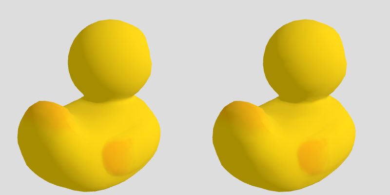 | 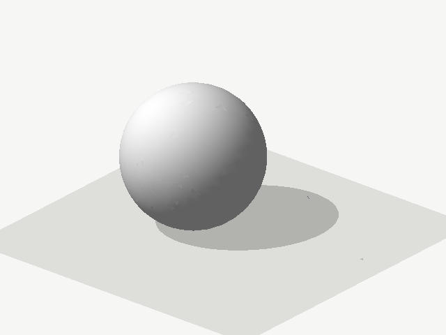 | 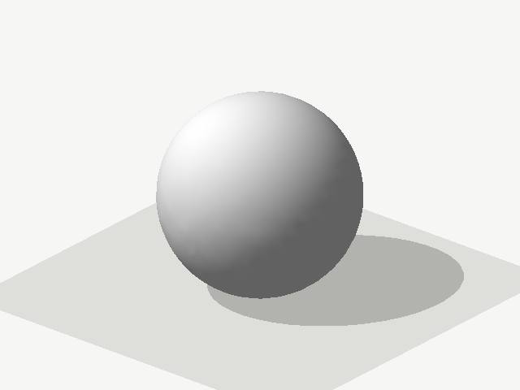 |
| Khronos's Duck, as imported and decimated to half, its texture kept (three.js render, `docs/research.md` §17). | `golden/meshes/ball_defects.obj` as it comes: open, in 2 pieces, 79 faces flipped. | After `shape process --budget 1500`: closed, 1 piece, 1 500 triangles, 6 UV charts with no overlap (the lines are chart seams). |

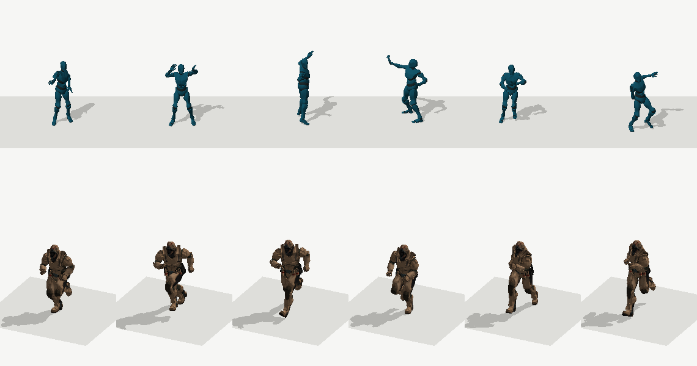

Skinned files are read with their animations and drawn posed (`shape
preview file --clip Run --frames 6`): three.js's Samba (FBX, 55 320
triangles) over its 18 s, and Mixamo's soldier (GLB) running, with its
maps (progressive JPEGs).

| | |
|---|---|
| 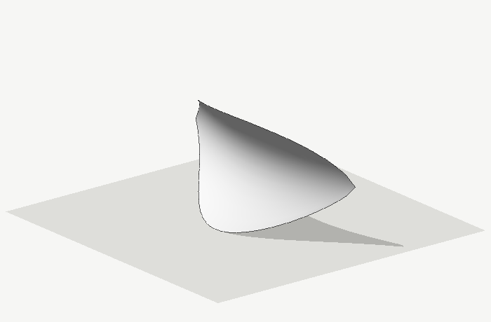 | 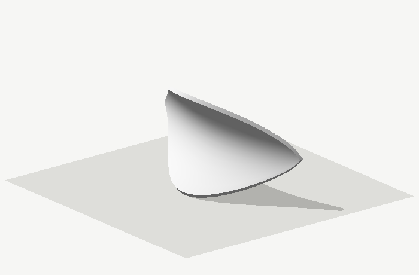 |
| An open sheet (`docs/previews/readme/src/leaf.obj`, 756 triangles, 56 open edges): no inside, no volume. | After `shape repair --thicken 1.2`: a second sheet under it and a rim along its edge, closed, 1 780 mm³, no triangle pair crossing. |

| | |
|---|---|
| 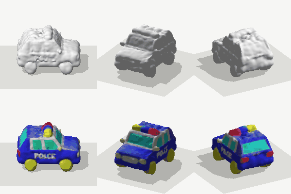 | 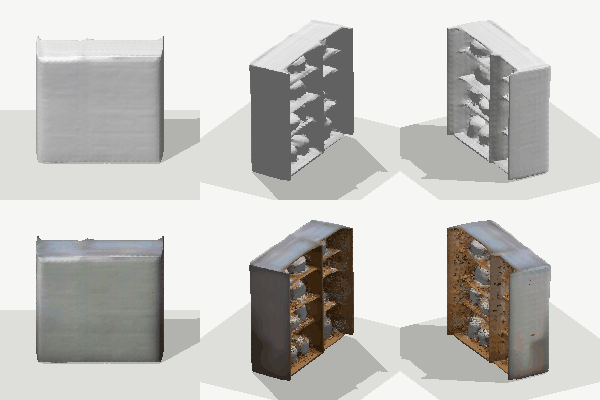 |
| A Meshy police car (37 000 triangles, a 2048² JPEG map) in `shape preview`: top before it drew maps, bottom with its base-colour map sampled per pixel (`docs/research.md` §30). | A SPAR3D cabinet, the same way: the wood inside the grey shell shows only with the map. Its normal map is not drawn. |
| 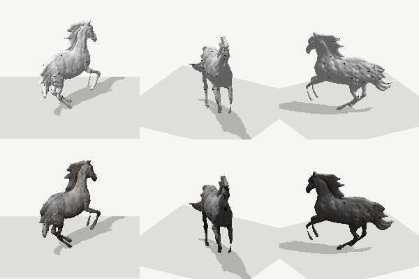 | 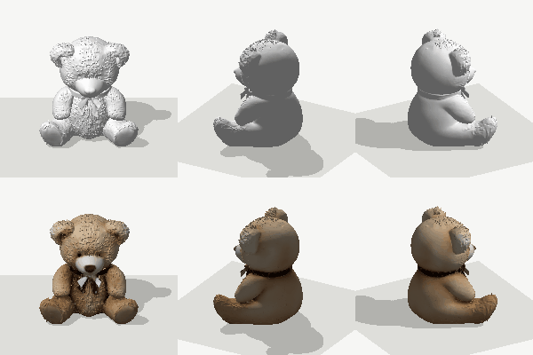 |
| A TripoSR horse, coloured only by its vertex colours: top before the preview drew them, bottom after (§30). | A Hunyuan3D-2 bear (150 000 triangles), the same way, with its base-colour map. |
| 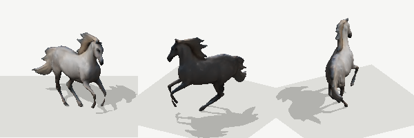 | 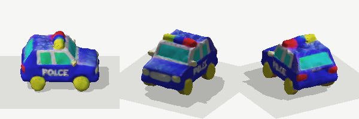 |
| The same horse through the whole chain: `shape process --budget 10000` with its colours, stood up from TripoSR's Z-up frame on its base at 2 m (`--up +z --front +x --pivot base --height 2m`), then previewed (§33). | The police car the same way: 10 000 triangles, its maps shrunk to 1024² (`--texture-max 1024`), 4.8 m long. |
| 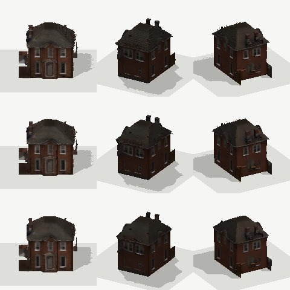 | 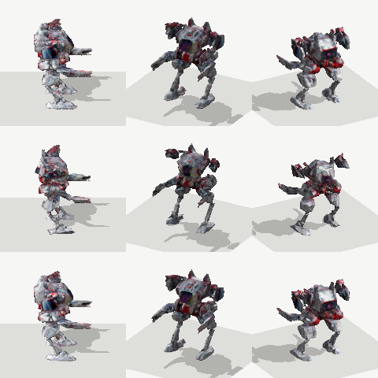 |
| A Hunyuan3D-2 house (150 000 triangles): top the source, middle keeping its UVs (stuck at 7 266 triangles for a budget of 2 000), bottom `--bake 1024` at 2 000 triangles with its look baked into a new atlas (§34). | Meshy's robot the same way: keeping UVs it stops at 3 384 triangles with its legs damaged; baked, 2 000 triangles in its shape and colours. |

`docs/previews/` holds more: the bevel cases (`phase3/`), a skinned
figure and Mixamo's Soldier posed (`phase5b/`), the models loaded and
moved in three.js (`validate/`), UVs under a checker (`uv/`), twelve
generated meshes before and after the chain, thirteen before and
after the preview drew their colour, thirteen through the whole
chain with their look and placement, and sixteen kept and baked at
2 000 triangles (`generated/`).

## What has been checked

Run on `main` on 2026-11-10 and 11; each line says where the numbers come from.

| Check | Result | How |
|---|---|---|
| The same bytes on every host | 165 golden output hashes equal on x86-64 Linux, x86-64 Windows, aarch64 Linux, aarch64 macOS and wasm32 (wasmtime); the binding's GLB and PNG equal under bun and node | the gate in GitHub Actions, every push |
| Tests | 375 pass | `scripts/check.sh test` |
| An agent with only the guides and the MCP tools builds objects | 20 of 20 sand3d dataset objects built, every part closed, 24 of 24 joints as the reference, 2.0 builds an object, 19 ran on the first build | `eval/phase6`, run `Z1` (`docs/research.md` §22) |
| Those 20 programs on today's kernel | 20 of 20 rebuild and export to GLB; 119 of 119 parts closed, no non-manifold edge, no degenerate triangle | `shape measure` on each `program.json` |
| Every committed program | 105 of 107 build (`eval/phase6/**`, `golden/programs/`); the two that do not are a refusal a golden case hashes on purpose and a trial program with a joint declared twice | `shape build` on each |
| No part passes through itself | 140 of 140 built solids have no crossing triangle pair (exact predicates). The mouse's shell had 8: its move into the world folded a needle, now repaired (`docs/research.md` §26) | `crates/shape-model/tests/built_parts.rs`, `shape_bool::crossing_pairs` on every part |
| Bevels never return a wrong result | 17 948 fillets and chamfers on generator and boolean solids: 16 648 built, 1 300 refused with an error value, none returned crossing itself | `cargo run --release -p shape-bevel --example scan` |
| Booleans against outside meshes | 109 cases from sand3d, Thingi10K, synthetic defects and touching operands; no ok output crosses itself with the repair on | `bench/booleans` (`docs/research.md` §25.2) |
| Real generated meshes | 54 files from 8 image- and text-to-3D generators (Hunyuan3D-2, TRELLIS, SPAR3D, TripoSR, InstantMesh, CRM, Unique3D, Meshy): within budget and closed keeping their UVs and texture 39, 51 and 52 at 2 000, 10 000 and 50 000 triangles, 51, 52 and 52 with fresh UVs (the 2 open ones are TRELLIS meshes; Unique3D's chair keeps its vertex-colour borders and misses 2 000, which `--cross-color-borders` reaches at 7.4 mm); decimation folds none through itself (outputs crossing themselves at 10k: 2, both inputs that crossed); 143 of 154 booleans on the results closed, 7 refused with a cause, 4 missed; at 10 000 triangles all 54 keep their material factors, the 40 textured ones every map and the 14 vertex-coloured ones their colours, and `--texture-max 1024` brings the 16 files over 16 MiB of texture under 11 MiB | `bench/generated` (`docs/research.md` §28, §29, §32, §33) |
| Baking generated meshes to a game's budget | `process --bake 1024`: all 54 within 2 000 and 10 000 triangles (52 closed; the 2 TRELLIS meshes open after repair), every one with a baked base-colour and normal map (15 with metallic-roughness), 1 texel without a source in 108 runs; keeping UVs, 39 and 53. Colour error against the source (unlit, 256², 0–255) where both reach 2 000: 3.6 baked, 5.6 kept (median); 3–4 s and about 50 MiB for a 1024² bake | `bench/generated/bake.ts` (`docs/research.md` §34) |
| Generated meshes placed for a game | all 54 stand on z = 0 with the origin at the base's centre, at the size asked to 4e-8, facing front, with each generator's frame given as `up` and `front` (TripoSR `+z`/`+x`, InstantMesh `-z`/`+x`, SPAR3D and CRM `+y`/`-z`); no simple reading of the axis measures stands more than 22 up | `bench/generated/place.ts` (`docs/research.md` §31) |
| Shells thicker than the part's small faces | 7 280 shells of extruded polygons, rounded rectangles and circles with plain, tapered, chamfered and filleted bottoms, 1 to 30 thick, open or closed: 5 697 clean, none crossing itself (950 at first), 172 refused because the walls would meet, 1 refused otherwise, 1 410 asked to open a face that is not flat. A case with a pocket (not convex), 10 thick with corners of radius 5: no crossing pair, the hollow's volume exact | `cargo run --release -p shape-edit --example shell_sweep` (`docs/research.md` §27, §35, §37, §38) |
| Shells of parts with pockets, holes, bosses and handles | a case whose pocket's wall reaches through its own (two chambers), walls exactly twice the thickness, a boss and a handle thinner than two walls (solid through), an L pocket: no crossing pair, each hollow's volume the closed form to 1e-6. A can with a hole through its side, holes in an open face, a pocket in a pocket: no crossing pair | `crates/shape-model/tests/rest.rs` (`docs/research.md` §38) |
| Skinned files | Mixamo's soldier (two skinned parts, one on part of the skeleton) and three.js's Samba through `repair`, `process` (decimated, placed at 1 m) and `decimate`: written back with bones, skin, UVs and map; Samba's levels at 27 660, 13 830, 5 532 and 5 000 triangles each exact, its floor 3 564 | `docs/research.md` §39 |
| A file's animations | glTF and FBX clips sampled into skinning matrices: a hand-written file of each kind posed at the start, the middle and the end of a quarter turn to 0.05 mm (also under an armature scaled 0.01); the soldier's four clips and Samba's one drawn posed, and kept through `process` and `decimate` (written, read back, the same motion to 0.05 mm) | `crates/shape-tools/tests/meshtools.rs`, `crates/shape-tools/src/fbx.rs` (`docs/research.md` §40) |
| Repair's memory | `process` on a 619 000-triangle vertex-coloured mesh (Unique3D's bear) peaks at 879 MiB (2 663 before), 1 497 MiB with `--fuse` (3 366), in the same time, with byte-identical output | `docs/research.md` §36 |
| A loft along a path | a loop of twelve squares round a ring, straight between: its volume to 1e-9 of the closed form; on a curve, within 1 % of the torus; a bend tighter than its sections is refused | `crates/shape-gen/src/loft.rs`, `crates/shape-model/tests/rest.rs` |
| Clips | a clip read back from its GLB with an independent glTF reader: a rotation channel on the joint's node and a translation on its follower's, a turn of 3 radians in steps of a quarter turn at most, the last key equal to the node of the scene posed there. The washing machine's `open` (hinge and drawer) and `spin` (the drum's full turn, 5 keys) export as two animations | `crates/shape-tools/tests/export.rs`; `golden/programs/washing_machine_clips.json` |
| Colliders | the washing machine's 7 parts covered by 19 convex hulls of at most 16 vertices in 4 s; an octagonal cup's hollow kept by 16 hulls (41 mm bridged, against 310 mm by one) | `shape collide` (`guides/meshtools.md`) |
| The mesh chain on a damaged mesh | open, 2 pieces, 79 flipped faces → closed, 1 piece, on budget, unwrapped with no UV overlap | `shape process golden/meshes/ball_defects.obj` |
| Outside files | glTF, OBJ and FBX from three.js's and Khronos's samples import; textured and skinned ones keep UVs, bones and weights through repair and decimation to half | `docs/research.md` §9, §11.5, §17 |
| three.js reads the output | the washing machine's joints move and a skinned figure poses in headless Chromium; vertex positions match the kernel's own pose | `docs/research.md` §19 |
| A real MCP client | the official TypeScript SDK client and headless Claude Code drive every tool and resource | `docs/research.md` §19 |

Known limits. Each is an error value or a recorded gap; the one marked
silent returns a result with no error:
- **Silent, measured:** a boolean or edit whose result still crosses
  itself after the repair is returned without an error, with the count in
  its report (`crossingPairs`, `BoolReport::crossing_pairs`,
  `shape_edit::EditReport`). No committed program, golden case other than
  `selfunion.check` (its inputs cross by design), bench case, or swept
  `hole`, `pocket`, `seat` or `dent` leaves any. A shell still answers
  pairs, or is refused, where holes cross each other inside the part or
  a pocket's mouth is rounded narrower than the wall
  (`docs/research.md` §38).
- 1 300 of the scan's bevels are refused: too large for the faces (426),
  a lone piece of a crease that does not fit (226), a twisted face (340),
  an edge with more than two faces (308).
- The unwrap is planar per chart. The preview
  draws base-colour and normal maps (PNG, baseline JPEG), vertex colours
  and the emissive colour, but no metallic-roughness or emissive maps,
  and no metalness or roughness factors.
- A mesh of 600 000 triangles with colours is about 300 MiB in memory
  as a `Solid`, and `process` holds the file and two of them at its
  peak: 0.9 GiB on Unique3D's 620 000-triangle bear, 1.5 GiB with
  `--fuse` (`docs/research.md` §36). Only that file was measured after
  the change.
- Keeping a file's UVs, decimation stops at about three triangles a UV
  island: 14 of 54 generated meshes miss 2 000 triangles (the report's
  `blocked` says why); merging rigidly matching islands lowers that
  3–25 %. `--bake` reaches the budget by resampling the look into a new
  atlas: where keeping also reaches it (10 000 triangles) the bake looks
  less like the file (median colour error 2.9 against 1.6 of 255), its
  maps double a single-map file's texture memory, and its normal map is
  in this kernel's tangent frame (written as `TANGENT`), not MikkTSpace
  (`docs/research.md` §34).
- Repair leaves open, and reports, non-manifold edges that no pairing of
  their faces separates and holes over 64 edges that no flat clear fill
  closes: 2 of TRELLIS's 6 meshes (`docs/research.md` §32).
- Not read: FBX blend shapes, a morph target's normals, a second UV
  set. Draco- and meshopt-compressed glTF are read. Vertices at one
  place are one vertex to the tools, so a morph target that parts them
  (lips that touch at rest) moves them together after a weld; `import`
  counts such places. No USD or URDF export. `thicken` gives an open
  sheet one thickness everywhere; where the sheet curves tighter than
  that its second sheet folds (counted by `--intersections`).
- An imported mesh's normals are recomputed, smooth within a surface: a
  normal map baked against the file's normals shades a median 1–1.6°
  differently after repair alone. The texture budget writes PNG only (no
  KTX2 or Basis); a
  plain GLB has one material, so parts whose materials differ lose
  theirs (reported).
- `place` turns, sizes and moves a mesh to its base, but does not
  choose its up or front: the author says them, per generator
  (`guides/meshtools.md`). A program's export has no pivot option; the
  program places its own parts.
- The declarative `.ogt` source and `og cook` belonged to the merge into
  origin-engine, which is dropped: a program is JSON or TypeScript.

## Use it

From an agent, through MCP (`guides/mcp.md`):

```sh
cargo build --release -p shape-mcp
claude mcp add og-shape -- "$PWD/target/release/shape-mcp" --root /path/to/workspace
```

The agent then has `build`, `preview`, `measure` and `export` for model
programs, `run_typescript` for TypeScript ones (with bun and
`crates/shape-wasm/build.sh`), and `import`, `repair`, `decimate`,
`unwrap`, `place` and `process` for meshes from elsewhere. It reads how to write a
program from the server's resources (`guides/`).

From a shell, the same commands (`cargo run -p shape-cli -- help`):

```sh
shape build   model.json                     # parts and joints as JSON
shape preview model.json -o model.png        # a turntable, CPU-rendered
shape export  model.json -o model.glb        # or .obj, .stl
shape process scan.glb --budget 40000 --weld 0.001 --floaters 0.05 \
              --non-manifold --holes 64 --fuse -o asset.glb
                                             # repair, decimate, unwrap
shape repair  leaf.obj --thicken 1.2 -o leaf.glb   # an open sheet made solid
shape collide model.json --hulls 8 -o colliders.glb  # convex colliders
```

## Read

- `docs/design.md`: goals, scope, API, architecture, determinism.
- `docs/plan.md`: phases, acceptance and status.
- `docs/research.md`: what has been verified so far: sand3d's real Blender
  dependencies, the library survey, the platform's current 3D pipeline,
  and what the engine already covers.
- `AGENTS.md`: rules for anyone working in this repository.

Licence: MIT (`LICENSE`). Third-party code keeps its own licence under
`third_party/`.
